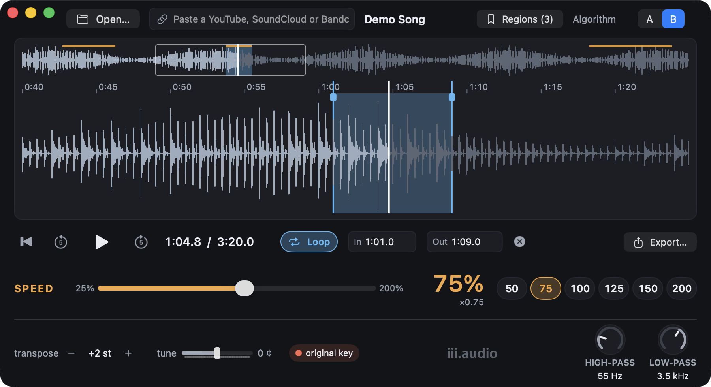

# GawdSpeed

A practice and transcription player for macOS. Load a song, slow it down or speed
it up without changing its key, loop the hard part, and work it out by ear.



> **Status:** beta (0.1.1), in use by testers. Signed, notarized builds are shared
> privately for now; you can build it from source below. The full two-page guide is
> [docs/guide/GawdSpeed-Guide.pdf](docs/guide/GawdSpeed-Guide.pdf).

## Features

- **Speed from 25% to 200%** with the key unchanged, plus 50/75/100/125/150/200 presets.
  At 100% with no key change, the original audio plays untouched.
- **Transpose** (±12 semitones) and **tune** (±50 cents), independent of speed.
- **Two time-stretch algorithms** to compare by ear, switchable while playing:
  **A** = [Signalsmith Stretch](https://github.com/Signalsmith-Audio/signalsmith-stretch),
  **B** = [Rubber Band Library](https://breakfastquay.com/rubberband/) (R3 engine).
- **Waveform:** an overview of the whole song plus a zoomable detail view with a time ruler.
- **Loops and regions:** drag to highlight a section and loop it seamlessly, with
  zero-crossing snap and optional pre-roll; save named regions ("Bridge lick") per song.
- **High-pass and low-pass filters** for picking out a bass line or a hi-hat part.
- **Export** the slowed-down audio, or just the highlighted section, as WAV, AIFF, FLAC,
  ALAC, AAC or MP3.
- **Opens almost anything:** WAV, MP3, AAC, FLAC, AIFF, Ogg, Opus, WebM, video files and
  more, through a bundled ffmpeg. It can also pull the audio from a YouTube, SoundCloud
  or Bandcamp link (via yt-dlp).
- **Remembers each song:** speed, key, filters, loop, regions and position come back
  when you reopen it. Undo and redo cover the controls and loops.
- **Built for practice:** keyboard-driven, with every action in the menus and a tooltip
  on every control. The whole interface scales with the window, so it reads from across
  the room.

## How it's built

- **A real-time C++ audio engine** (`Bridge/`): one render path for playback and export,
  so what you hear is what you export. The audio thread never allocates or locks;
  parameters arrive through atomics. Seeks, loop wraps, algorithm switches and bypass
  changes all crossfade, so nothing clicks.
- **A SwiftUI app** (`Sources/`) on top of `AVAudioEngine`, with decoding through
  AVFoundation and a bundled, self-built ffmpeg for everything else.
- **Tests that measure** (`Tests/`, 59 of them, run in CI on every push):
  - pitch held to within a cent at every speed
  - durations to the frame
  - an export that matches playback to within float rounding (−138 dB)
  - a five-minute loop with no clicks

  Each measuring instrument is first checked against signals with known answers, and
  each check has a negative control that proves it can fail.
  [docs/FINDINGS.md](docs/FINDINGS.md) records what the measurements turned up.
- **Release pipeline** (`scripts/release.sh`): builds from a clean copy of a pushed
  commit, signs with a Developer ID, notarizes with Apple, and packages a DMG. The
  app's About window links to the exact source of the build.

### CPU cost

Measured offline by `PerformanceTests`: 30 s of stereo 48 kHz audio, three interleaved
runs, on an Apple M5 Max (2026-10-06). One machine, so treat these as orientation
rather than a benchmark.

| Path | CPU, % of one core |
|---|---|
| 100% speed, no key change (bypass, untouched audio) | 0.01 |
| Algorithm A (Signalsmith Stretch) at 50% | 0.42 |
| Algorithm B (Rubber Band R3) at 50% | 2.86 |

## Building

Requires macOS 14+, Xcode, and [XcodeGen](https://github.com/yonaskolb/XcodeGen)
(`brew install xcodegen`). `scripts/build-ffmpeg.sh` builds the bundled ffmpeg
(about a minute); without it the app falls back to a Homebrew ffmpeg if there is one.

```bash
scripts/build-ffmpeg.sh
xcodegen generate
xcodebuild -project GawdSpeed.xcodeproj -scheme GawdSpeed -destination 'platform=macOS' test
scripts/check-licenses.sh
```

## License

GawdSpeed is free software, licensed under the GNU General Public License,
version 3 or (at your option) any later version. See [LICENSE](LICENSE).

It builds on the Rubber Band Library (GPL-2.0-or-later), Signalsmith Stretch (MIT),
FFmpeg (GPL) and LAME (LGPL). See [THIRD_PARTY_NOTICES.md](THIRD_PARTY_NOTICES.md)
and [LICENSES/](LICENSES/) for every third-party component and its license. The
iii.audio name and logo and the app icon are not covered by the GPL. Contributions are
welcome under the same license; see [CONTRIBUTING.md](CONTRIBUTING.md).

Copyright (C) 2026 Earl Scioneaux, III · [iii.audio](https://iii.audio)
